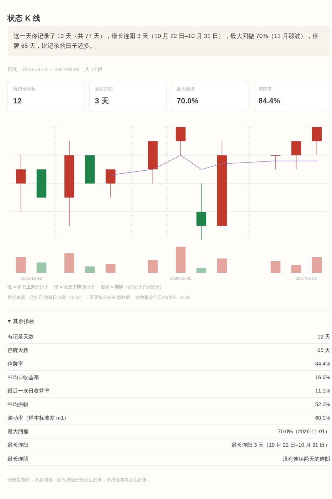

# life-kline

**每天 30 秒自评，把你的日子画成一张 K 线图。纯本地、单文件、可分享形状。**

<p align="center">
  
</p>

<sub>截图占位：上面的图由 `fixtures/full.csv` 生成，`life-kline chart --out life.html` 后直接打开就是这个样子。</sub>

## 它是什么

一个命令行工具。每天回答 4 个问题，30 秒：

```bash
life-kline add
```

```
早上起来的时候，你的状态大概几分？（0–10） 6
今天最好的那个时刻，能打到几分？ 8
今天最糟的那个时刻，掉到几分？ 4
现在，睡前，几分？ 7
```

回答完，这一天就变成了一根 K 线。跑几次以后：

```bash
life-kline chart --period week --out life.html
```

得到一个**单独的 HTML 文件**，双击就能看，没有服务器、没有账号、没有 JavaScript。

再想要个能发出去的版本：

```bash
life-kline chart --mask --out share.html
```

只保留形状，没有数字。

## 命令

```bash
life-kline init                        # 初始化 CSV（默认 ~/life-kline.csv，可 --path 指定）
life-kline add                         # 交互录入
life-kline add --date 2026-10-21 --open 5 --high 9 --low 3 --close 8
life-kline chart --period day|week|month|year --out life.html
life-kline chart --mask --out share.html
life-kline stats [--from --to]         # 终端输出 7 个指标
life-kline gaps                        # 列出停牌日与停牌率
life-kline verify                      # 只校验 CSV
```

只用 Python 3.10+，**没有任何第三方依赖**。

## 三件它坚决不做的事

**一、不预测。** 只描述已经发生的事。没有「明天会更好」，也没有「趋势将继续」。
所有指标只吃过去的数据，代码里有静态测试盯着这一点。

**二、不插值。** 某天没记录，那天就是停牌——图上一段空白，不补、不猜、不用前一天的值顶上。
「你已经 17 天没记录」本身就是这个工具要告诉你的事，补上了就看不见了。

**三、不装客观。** 所有分数都是**自评**。它不叫「人生指数」，就叫状态。
0 分不代表你的人生是 0，只代表你那天早上给自己打了 0。

## 隐私声明

- **数据只在本机。** 默认存在 `~/life-kline.csv`，一个纯文本文件，你可以用任何编辑器改。
- **工具没有任何上传能力。** 源码里不含 `socket` / `urllib` / `http` / `requests` / `ssl` 等模块的
  import，`tests/test_no_network.py` 用 `ast` 逐个文件静态扫描，加一行 `import socket` 测试就会红。
- **生成的 HTML 不引用任何外部资源。** 没有 CDN、没有在线字体、没有外链图片、没有 `<script src>`。
  断网打开也完全一样，打开时不会发出任何请求。
- **源码可自证。** `cli.py` + `core/` 一共约 1300 行，纯标准库，读一遍就能确认上面这些。

## 诚实声明

- 分数是**自评**，不是测量，不是诊断，不是心理量表。
- 图只描述过去，**不预测未来**。
- 「停牌率」高不代表你不好，它只说明你有些天没打开这个工具。
- 这个工具不给你建议。它只把你说过的话排成一张图。

## 数据格式

一行一天，手写也行：

```csv
date,open,high,low,close,volume,note,tags
2026-10-18,6,8,4,7,12,下午把那个 bug 修了,work
2026-10-19,7,7,5,5,8,,tired
2026-10-20,,,,,,,
2026-10-21,5,9,3,8,15,早上很糟下午反转,breakthrough
```

| 列 | 含义 |
|---|---|
| `date` | 日期，`YYYY-MM-DD` |
| `open` / `high` / `low` / `close` | 早上 / 最好时刻 / 最糟时刻 / 睡前的状态，0–10 整数 |
| `volume` | 这一天做了多少事，可空，非负整数 |
| `note` | 备注，可空，不参与计算 |
| `tags` | 标签，分号分隔，可空 |

**整行四个分数全空 = 停牌**，合法。只填一部分会报错——不猜。

校验失败时报告格式：

```
第 3 行：2026-10-18 的字段 `high` (4) 不能小于 close (8)
```

## 开发

```bash
python3 -m unittest discover -s tests -t .
```

零依赖，不需要装任何东西。

想亲眼确认「没有联网代码」不是一句空话，可以跑一次实证脚本：
它会往 `core/metrics.py` 里临时注入 `import socket`，确认测试真的会变红，然后恢复原样。

```bash
python3 tools/red_green_check.py
```

设计文档见 [docs/ARCHITECTURE.md](docs/ARCHITECTURE.md)，里面有核心映射表、三条红线的由来、
聚合规则、7 个指标的定义，以及为什么职责边界不能破。

## 目录

```
life-kline/
├── cli.py
├── core/
│   ├── model.py       # Day / Candle + 0–10 校验
│   ├── store.py       # CSV 读写（唯一碰磁盘）
│   ├── aggregate.py   # 日 → 周/月/年
│   ├── metrics.py     # 7 个指标（纯函数，不碰文件）
│   ├── narrate.py     # 一句回顾
│   └── render.py      # 单文件 HTML + 内联 SVG（不算指标）
├── presets/ask.md
├── docs/ARCHITECTURE.md
├── fixtures/full.csv
├── tests/
└── README.md
```

## 许可

自己用。顺手给别人用。
